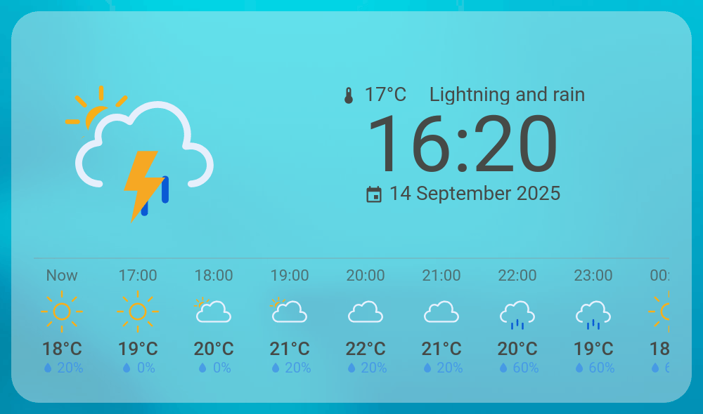
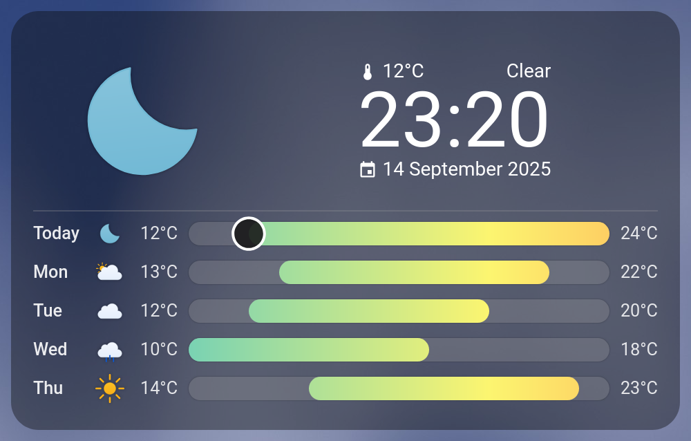
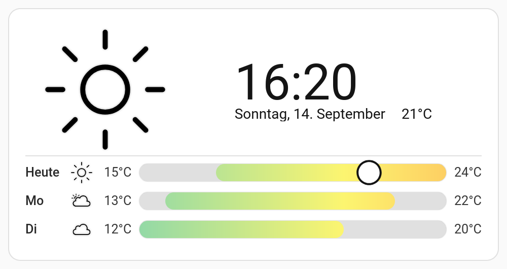

# Clock Weather Card

[](https://github.com/hacs/integration)
[](https://github.com/pkissling/clock-weather-card/releases)
[](https://github.com/pkissling/clock-weather-card/releases/latest)
[](https://github.com/pkissling/clock-weather-card/releases/latest)

An iOS-inspired clock and weather card for [Home Assistant](https://www.home-assistant.io/) dashboards, available through the [Home Assistant Community Store](https://hacs.xyz).


## Features

- **A header you compose yourself** - arrange the clock, date, current weather, any entity, icons and text in rows of segments.
- **Hourly and daily forecasts** - a horizontally scrolling strip and a list with temperature bars, each showing hours or days independently.
- **Beautiful, animated weather icons** - [Meteocons](https://github.com/basmilius/meteocons) in four styles: `line`, `fill`, `flat` and `monochrome`. Shout-out to the creator [Bas](https://github.com/basmilius)!
- **Any forecast attribute** - show wind speed, humidity, UV index or any other numeric attribute in the strip or as bars.
- **Sunrise and sunset** - marked in the hourly strip.
- **Fully customizable** - set your own color gradient for the forecast bars, pick icon styles and sizes per section, tune row heights, bar thickness, font sizes and alignment, choose date and time formats, and show or hide every section.
- **Localized** - Dozens of languages, locale-aware date and time formats, any time zone, and Celsius or Fahrenheit.
- **Visual editor** - set the card up in the dashboard UI, no YAML required.

## Installation

The card is installed through [HACS](https://hacs.xyz):

1. Make sure HACS is installed.
2. Open the card in HACS and install it:

   [](https://my.home-assistant.io/redirect/hacs_repository/?owner=pkissling&repository=clock-weather-card&category=plugin)

   Or search for **Clock Weather Card** in HACS. If the button shows "not found", enable the [My Home Assistant](https://www.home-assistant.io/integrations/my/) integration.
3. Reload your browser. HACS registers the card as a dashboard resource automatically.
4. Add the card to your dashboard (see [Configuration](#configuration)).

If you manage your dashboards in YAML mode, add the resource yourself in `configuration.yaml`:

```yaml
lovelace:
  resources:
    - url: /hacsfiles/clock-weather-card/clock-weather-card.js
      type: module
```

## Configuration

Edit your dashboard, click **Add card** and pick **Clock Weather Card**. Every option below can be set in the dashboard's visual card editor: pick the weather entity, toggle and tune each section, build the header rows from segments and adjust the forecast list's color gradient. The editor only writes options that differ from their defaults, so the resulting YAML stays minimal. The code editor remains available for those who prefer YAML.

### Minimal configuration

<!-- preview: hero
theme: { repo: basnijholt/lovelace-ios-themes, version: v3.0.3, name: ios-dark-mode-dark-green }
dark: true
weather: { state: sunny, temperature: 16 }
animated: true
-->
```yaml
type: custom:clock-weather-card
entity: weather.home
```

The animation at the top of this page shows this configuration in the [iOS Dark Mode Dark Green](https://github.com/basnijholt/lovelace-ios-themes/tree/v3.0.3) theme.

### Examples

Every image in this README is rendered from the configuration shown next to it, so it always matches the current version of the card. Each example names the [theme](https://www.home-assistant.io/integrations/frontend/#defining-themes) it is shown in.

<table>
<tr><th>Configuration</th><th>Card</th></tr>
<tr><td>

<!-- preview: example-thunderstorm
theme: { repo: basnijholt/lovelace-ios-themes, version: v3.0.3, name: ios-light-mode-light-blue }
weather: { state: lightning-rainy, temperature: 17 }
animated: true
-->
```yaml
type: custom:clock-weather-card
entity: weather.home
sections:
  forecast_list:
    hide: true
```

</td><td>



*[iOS Light Mode Light Blue](https://github.com/basnijholt/lovelace-ios-themes/tree/v3.0.3)*

</td></tr>
<tr><td>

<!-- preview: example-night
theme: { repo: basnijholt/lovelace-ios-themes, version: v3.0.3, name: ios-dark-mode-dark-blue }
dark: true
weather: { state: clear-night, temperature: 12 }
sun: { state: below_horizon }
time_zone: Asia/Tokyo
-->
```yaml
type: custom:clock-weather-card
entity: weather.home
weather_icon_type: fill
sections:
  forecast_strip:
    hide: true
```

</td><td>



*[iOS Dark Mode Dark Blue](https://github.com/basnijholt/lovelace-ios-themes/tree/v3.0.3)*

</td></tr>
<tr><td>

<!-- preview: example-custom-header
language: de
-->
```yaml
type: custom:clock-weather-card
entity: weather.home
weather_icon_type: monochrome
sections:
  header:
    rows:
      - font_size: 3.5rem
        segments:
          - type: time
            time_pattern: HH:mm
      - segments:
          - type: date
            date_pattern: cccc, d. MMMM
          - type: spacer
          - type: weather
            attribute: temperature
  forecast_strip:
    hide: true
  forecast_list:
    count: 3
```

</td><td>



*[Home Assistant default](https://www.home-assistant.io/integrations/frontend/#themes)*

</td></tr>
</table>

### Card Options

| Name | Type | Required | Default | Description |
|------|------|----------|---------|-------------|
| `entity` | string | **yes** | - | Entity ID of your weather provider |
| `title` | string | no | `null` | Title displayed at the top of the card |
| `sun_entity` | string | no | `sun.sun` | Entity ID of the sun entity, used to determine day/night icons |
| `weather_icon_type` | `fill` \| `flat` \| `line` \| `monochrome` | no | `line` | Visual style of the weather icons ([meteocons](https://github.com/basmilius/meteocons)). Applies to all sections; each section can override it with its own `weather_icon_type`. |
| `time_zone` | string | no | Home Assistant time zone | IANA time zone name (e.g. `Europe/Berlin`) used to render the clock. When unset, falls back to the time zone configured in Home Assistant. |
| `locale` | string | no | Home Assistant language | Language tag (e.g. `en-GB`, `de`, `pt-BR`) used for date/time formatting and translated text. When unset, falls back to the language configured in Home Assistant. |
| `temperature_unit` | `celsius` \| `fahrenheit` | no | Home Assistant unit system | Unit all temperatures are shown in (header, forecast strip, forecast list). Values from the weather entity and from `entity` segments with a `°C`/`°F` unit are converted. When unset, falls back to the temperature unit of the Home Assistant unit system. |
| `temperature_sensor` | string | no | - | Entity ID of a temperature sensor (unit `°C` or `°F`) that replaces the weather entity's current temperature everywhere the card shows it: the `temperature` weather segment, the forecast list's current temperature dot and the "Now" entry of the hourly forecast strip. Values are converted to `temperature_unit`, shown with at most one decimal and rounded per section by `round_temperatures`. While the sensor is `unavailable` or `unknown`, the current temperature is hidden and the strip shows the forecast value. |
| `tap_action` | object | no | `more-info` | [Action](https://www.home-assistant.io/dashboards/actions/) to run when the card is tapped, e.g. `navigate`, `url`, `more-info` (of `entity`) or `perform-action`. Set `action: none` to make the card not clickable. |
| `sections` | object | no | - | Per-section configuration. See [Sections Options](#sections-options). |

### Sections Options

Sections render top to bottom in the order `header`, `forecast_strip`, `forecast_list`.

#### `header`

Renders the current-weather icon next to the configurable rows of segments (clock, date, current weather, entities, icons) at the top of the card. By default the icon is as tall as the rows, but at least `9rem`; `weather_icon_size` overrides this. The icon never grows beyond half the card width.

| Option | Type | Required | Default | Description |
|--------|------|----------|---------|-------------|
| `hide` | boolean | no | `false` | Hide the header section. |
| `animated_icons` | boolean | no | `true` | Whether the large weather icon should be animated. |
| `weather_icon_type` | `fill` \| `flat` \| `line` \| `monochrome` | no | top-level `weather_icon_type` | Visual style for the large weather icon. Falls back to the card's main `weather_icon_type` when unset. |
| `weather_icon_size` | string | no | height of the rows, at least `9rem` | CSS length for the height of the large weather icon, capped at half the card width. Accepts `px`, `rem`, `em`, `vh`, `vw`, `%` (relative to half the card width). |
| `rows` | list | no | See [Default Header Rows](#default-header-rows) | List of rows to display. See [Row Options](#row-options). |

#### `forecast_strip`

Renders a horizontally scrolling strip of upcoming hours (`forecast_type: hourly`, default) or days (`forecast_type: daily`) below the header. Each column shows a label, weather icon, temperature and one additional forecast attribute (precipitation probability by default, see `attribute`). Attribute columns without a value stay blank, and the row is hidden entirely when every visible column is `0` or has no value. Enabled by default. Requires a weather entity that advertises the `FORECAST_HOURLY` or `FORECAST_DAILY` supported feature, matching `forecast_type` - if the selected entity does not, the section renders an inline warning instead.

In hourly mode, the first column is labeled "Now" and is sourced from the most recent forecast entry whose timestamp is at or before the current time. Subsequent columns are the upcoming forecast hours.

In daily mode, the first column is labeled "Today" (localized) and the others show the weekday. Each column shows the day's high temperature with the low below it.

In hourly mode, when the next sunrise or sunset (taken from `sun_entity`) falls within the visible hours, an extra column with its exact time and an up (sunrise) or down (sunset) arrow is inserted at the matching position. These columns count toward `count`.

When the configured columns do not fit the card width, the strip scrolls horizontally (swipe, trackpad, Shift + mouse wheel, or the thin scrollbar below the strip).

| Option | Type | Required | Default | Description |
|--------|------|----------|---------|-------------|
| `hide` | boolean | no | `false` | Hide the forecast strip section. |
| `weather_entity` | string | no | top-level `entity` | Weather entity whose forecast is displayed. Falls back to the card's main `entity` when not set. |
| `forecast_type` | `hourly` \| `daily` | no | `hourly` | Forecast data shown in the strip. |
| `count` | number | no | `24` | Maximum number of columns to render, including the leading "Now"/"Today" entry and any sunrise/sunset columns. Fewer are shown if the provider returns less. |
| `animated_icons` | boolean | no | `false` | Whether the strip's weather icons should be animated. Defaults to `false` to keep the strip lightweight. |
| `round_temperatures` | boolean | no | `true` | When `true`, temperatures in the strip are rounded to the nearest integer. Set to `false` to show fractional values (if the weather provider has fractionals). |
| `weather_icon_type` | `fill` \| `flat` \| `line` \| `monochrome` | no | top-level `weather_icon_type` | Visual style for the icons in the forecast strip. Falls back to the card's main `weather_icon_type` when unset. |
| `hide_sunrise_sunset` | boolean | no | `false` | Hide the sunrise/sunset columns. Only supported with `forecast_type: hourly`. |
| `time_pattern` | string | no | `t` | [Luxon](https://moment.github.io/luxon/#/formatting?id=table-of-tokens) format pattern for the hourly and sunrise/sunset column labels. The default `t` is the localized short time (e.g. `15:00` for `en-GB`, `3:00 PM` for `en-US`); `H` shows only the hour. |
| `attribute` | string | no | `precipitation_probability` | Any numeric forecast attribute provided by the weather entity (e.g. `wind_speed`, `humidity`, `uv_index`), shown in the row below the temperature. See [Forecast attributes](#forecast-attributes). |
| `attribute_icon` | string | no | `mdi:water` if `attribute` is unset, otherwise none | Icon shown before each attribute value. |
| `attribute_unit` | string | no | resolved unit (see [Forecast attributes](#forecast-attributes)) | Unit shown after each attribute value, overriding the resolved one. Values are not converted. Set to `""` to show no unit. |
| `attribute_color` | string | no | `#3988EF` if `attribute` is unset, otherwise the theme's info color (text color with `weather_icon_type: monochrome`) | CSS color of the attribute row, e.g. `"#4a90d9"` or `var(--warning-color)`. Applies regardless of `weather_icon_type`. |

#### `forecast_list`

Renders a vertical list of upcoming days (`forecast_type: daily`, default) or hours (`forecast_type: hourly`) below the forecast strip. Each row shows a label, a weather icon, a low and high temperature, and a horizontal temperature bar. All bars share a single axis from the lowest low to the highest high across the visible rows, and each bar's gradient covers the configured color ramp clipped to that row's range.

In daily mode, each row spans the day's low and high. Today's row is labeled "Today" (localized) and shows a dot indicator at the current temperature on its bar.

In hourly mode, the first row is labeled "Now" and the others show the time (see `time_pattern`). Each row's bar spans from the previous hour's temperature to this hour's; the "Now" row starts from the current temperature and shows the current-temperature dot.

Requires a weather entity that advertises the `FORECAST_DAILY` or `FORECAST_HOURLY` supported feature, matching `forecast_type` - if the selected entity does not, the section renders an inline warning instead.

| Option | Type | Required | Default | Description |
|--------|------|----------|---------|-------------|
| `hide` | boolean | no | `false` | Hide the forecast list section. |
| `weather_entity` | string | no | top-level `entity` | Weather entity whose forecast is displayed. Falls back to the card's main `entity` when not set. |
| `forecast_type` | `daily` \| `hourly` | no | `daily` | Forecast data shown in the list. |
| `count` | number | no | `5` | Maximum number of rows to render, starting from today (daily) or the current hour (hourly). Fewer are shown if the provider returns less. |
| `row_height` | string | no | `28px` | CSS length controlling the height of each day row. Drives both the icon size and the row's minimum height. Accepts `px`, `rem`, `em`, `vh`, `vw`, `%`. |
| `bar_thickness` | string | no | `60%` | CSS length controlling the thickness of the temperature bar. A percentage is relative to `row_height` (so the bar scales with the row); absolute units (`px`, `rem`, `em`, `vh`, `vw`) set a fixed thickness. The current-temperature dot scales with it. Thicker bars reduce the visible gap between adjacent rows. |
| `hide_current_temp_indicator` | boolean | no | `false` | When `true`, the dot showing the current temperature on today's row (daily) or the "Now" row (hourly) is not rendered. |
| `time_pattern` | string | no | `t` | [Luxon](https://moment.github.io/luxon/#/formatting?id=table-of-tokens) format pattern for the hourly row labels. The default `t` is the localized short time (e.g. `15:00` for `en-GB`, `3:00 PM` for `en-US`); `H` shows only the hour. |
| `animated_icons` | boolean | no | `false` | Whether the list's weather icons should be animated. Defaults to `false` to keep the section lightweight. |
| `round_temperatures` | boolean | no | `true` | When `true`, the low and high temperatures are rounded to the nearest integer. Set to `false` to show fractional values (if the weather provider has fractionals). |
| `weather_icon_type` | `fill` \| `flat` \| `line` \| `monochrome` | no | top-level `weather_icon_type` | Visual style for the icons in the forecast list. Falls back to the card's main `weather_icon_type` when unset. |
| `attribute` | string | no | `temperature` | Forecast attribute shown in the list: `temperature` or any numeric forecast attribute (see [Forecast attributes](#forecast-attributes)). For any attribute other than `temperature`, each row shows a single value right of its bar, which runs from `0` to the row's value; all bars share one axis spanning `0` and every visible value. The current-temperature dot is only shown for `temperature`. |
| `attribute_unit` | string | no | resolved unit (`temperature_unit` for `temperature`, see [Forecast attributes](#forecast-attributes)) | Unit shown after each value, overriding the resolved one. Values are not converted. Set to `""` to show no unit. |
| `gradient` | map | no | built-in ramp (see below) | Map of value → hex (`#rgb`, `#rrggbb`) or `rgb()` color used to colorize the bars. For `temperature`, keys are in °C regardless of the weather entity's unit; for other attributes, keys are in the attribute's own unit. Colors are linearly interpolated between adjacent stops. |

The built-in gradient is:

```yaml
gradient:
  -10: "#78A2CC"  # darker blue
  0:   "#A4C3D2"  # light blue
  10:  "#79D2B3"  # turquoise
  20:  "#FCF570"  # yellow
  30:  "#FF964F"  # orange
  40:  "#FFC09F"  # red-ish
```

#### Forecast attributes

`forecast_strip.attribute` and `forecast_list.attribute` accept any numeric attribute of the weather entity's forecast entries, shown as provided (no rounding, except that the strip rounds `precipitation_probability` to the nearest 10); non-numeric values are treated as missing. If no forecast entry has the configured attribute, the section renders an inline warning instead (the strip's default `precipitation_probability` is exempt and simply hides the row). The unit is resolved the same way as for the [`weather` segment](#weather) (e.g. `wind_speed_unit` for `wind_speed`, `%` for `humidity`, otherwise the entity's `<attribute>_unit` attribute).

### Row Options

Each header row is a horizontal line of segments.

| Option | Type | Required | Default | Description |
|--------|------|----------|---------|-------------|
| `segments` | list | **yes** | - | List of segments in this row |
| `font_size` | string | no | inherited | CSS font-size (e.g. `14px`, `3rem`) |
| `alignment` | `left` \| `center` \| `right` | no | start of the row | Horizontal position of the row's segments. Always refers to the physical side, also in right-to-left languages. Has no effect when the row contains a `spacer`. |

### Segment Types

#### `time`

Displays the current time, auto-updating every second.

| Option | Type | Required | Default | Description |
|--------|------|----------|---------|-------------|
| `type` | string | **yes** | - | `time` |
| `time_pattern` | string | no | `t` | [Luxon](https://moment.github.io/luxon/#/formatting?id=table-of-tokens) time format pattern. The default `t` is the localized short time (e.g. `15:27` for `en-GB`, `3:27 PM` for `en-US`). |

#### `date`

Displays the current date.

| Option | Type | Required | Default | Description |
|--------|------|----------|---------|-------------|
| `type` | string | **yes** | - | `date` |
| `date_pattern` | string | no | `DDD` | [Luxon](https://moment.github.io/luxon/#/formatting?id=table-of-tokens) date format pattern. The default `DDD` is the localized full date (e.g. `27 April 2026` for `en-GB`, `April 27, 2026` for `en-US`). |

#### `weather`

Displays the current weather state (localized) or a specific weather entity attribute.

| Option | Type | Required | Default | Description |
|--------|------|----------|---------|-------------|
| `type` | string | **yes** | - | `weather` |
| `attribute` | string | no | - | Weather entity attribute (e.g. `temperature`, `humidity`). If omitted, shows the localized weather state text. |
| `show_unit` | boolean | no | `true` | When `attribute` is set, append `unit` if configured, otherwise the attribute's known unit (the card's `temperature_unit` for `temperature`/`apparent_temperature`/`dew_point`, whose values are converted to it, `pressure_unit`, `wind_speed_unit` for `wind_speed`/`wind_gust_speed`, `visibility_unit`, `precipitation_unit`, `%` for `humidity`/`cloud_coverage`/`precipitation_probability`, `°` for `wind_bearing`), otherwise the `<attribute>_unit` attribute. |
| `unit` | string | no | - | Hard-coded unit appended to the attribute value, overriding the resolved unit. Useful for attributes without a known unit. Ignored when `show_unit` is `false`. |
| `unit_attribute` | string | no | - | Weather entity attribute the unit is read from, replacing the resolved unit described under `show_unit`; must exist on the entity. Values with a `°C`/`°F` unit are converted to the card's `temperature_unit`. |

#### `entity`

Displays a Home Assistant entity's state and unit.

| Option | Type | Required | Default | Description |
|--------|------|----------|---------|-------------|
| `type` | string | **yes** | - | `entity` |
| `entity_id` | string | **yes** | - | Entity ID (e.g. `sensor.temperature`) |
| `attribute` | string | no | - | Entity attribute to display; must exist on the entity. If omitted, shows the entity state + unit. |
| `show_unit` | boolean | no | `true` | Append the unit to the displayed value. Values with a `°C`/`°F` unit are converted to the card's `temperature_unit`. |
| `unit` | string | no | - | Hard-coded unit appended to the value, overriding the resolved unit. Ignored when `show_unit` is `false`. |
| `unit_attribute` | string | no | `unit_of_measurement` | Entity attribute the unit is read from; must exist on the entity. |

#### `icon`

Displays an MDI icon.

| Option | Type | Required | Default | Description |
|--------|------|----------|---------|-------------|
| `type` | string | **yes** | - | `icon` |
| `icon` | string | **yes** | - | MDI icon name (e.g. `mdi:thermometer`, `mdi:calendar`) |

#### `weather_icon`

Displays an MDI icon matching the current state of a weather entity (e.g. `mdi:weather-rainy` when it rains). Uses night variants for `sunny` and `partlycloudy` while the sun entity is below the horizon.

| Option | Type | Required | Default | Description |
|--------|------|----------|---------|-------------|
| `type` | string | **yes** | - | `weather_icon` |
| `entity_id` | string | no | card `entity` | Weather entity whose state drives the icon |

#### `text`

Displays static text.

| Option | Type | Required | Default | Description |
|--------|------|----------|---------|-------------|
| `type` | string | **yes** | - | `text` |
| `text` | string | **yes** | - | Text to display |

#### `spacer`

A flexible spacer that fills the remaining horizontal space, pushing the segments before and after it apart. To position a whole row, use the row's `alignment` instead.

| Option | Type | Required | Default | Description |
|--------|------|----------|---------|-------------|
| `type` | string | **yes** | - | `spacer` |

```yaml
# Temperature on the left, weather state on the right
- segments:
    - type: weather
      attribute: temperature
    - type: spacer
    - type: weather
```

### Default Header Rows

When no `sections.header.rows` are configured, the header displays the following default layout:

```yaml
rows:
  - segments:
      - type: icon
        icon: mdi:thermometer
      - type: weather
        attribute: temperature
      - type: spacer
      - type: weather
  - font_size: 4rem
    alignment: center
    segments:
      - type: time
  - alignment: center
    segments:
      - type: icon
        icon: mdi:calendar
      - type: date
```

## FAQ

<details>
<summary>Why don't I see the current day in my weather forecast?</summary>

Some weather providers do not include today's weather in their forecast data. If this happens, try switching to a different provider.
[Open Meteo](https://www.home-assistant.io/integrations/open_meteo/) is the default weather integration in Home Assistant and includes today's weather.

</details>

<details>
<summary>What do the forecast bars represent?</summary>

<!-- preview: faq-forecast-bars
-->
```yaml
type: custom:clock-weather-card
entity: weather.home
sections:
  header:
    hide: true
  forecast_strip:
    hide: true
```


The bars visualize the temperature range for each day relative to the overall forecast range.

- The full bar spans the overall low to overall high across all forecast days (10° to 24° in the example above).
- The colored portion represents the temperature range for that specific day (e.g. 15° to 24° today).
- The circle marks the current temperature (e.g. 21°).

This makes it easy to see the weather trend for the upcoming days at a glance.

_Thanks to @deprecatedcoder for this explanation from [#143](https://github.com/pkissling/clock-weather-card/issues/143)._

</details>

## Feedback and support

- **Bugs** - something is broken or behaves differently than documented: open an [issue](https://github.com/pkissling/clock-weather-card/issues/new/choose).
- **Feature requests and changes** - start a discussion in [Feature requests](https://github.com/pkissling/clock-weather-card/discussions/categories/feature-requests), where others can upvote and discuss them. Once an idea is agreed on, it becomes an issue for implementation.
- **Questions and configuration help** - ask in [Help & Configuration](https://github.com/pkissling/clock-weather-card/discussions/categories/help-configuration).

Issues that aren't bugs are moved to Discussions.

## Contributing

Contributions are welcome. See [CONTRIBUTING.md](CONTRIBUTING.md) for the development setup, testing requirements and how to add translations.

## Credits

- Weather icons: [Meteocons](https://github.com/basmilius/meteocons) by [Bas Milius](https://github.com/basmilius) (MIT License).
- Theme used in the screenshots: [lovelace-ios-themes](https://github.com/basnijholt/lovelace-ios-themes) by [Bas Nijholt](https://github.com/basnijholt).

## License

This project is licensed under the [MIT License](LICENSE.md).
